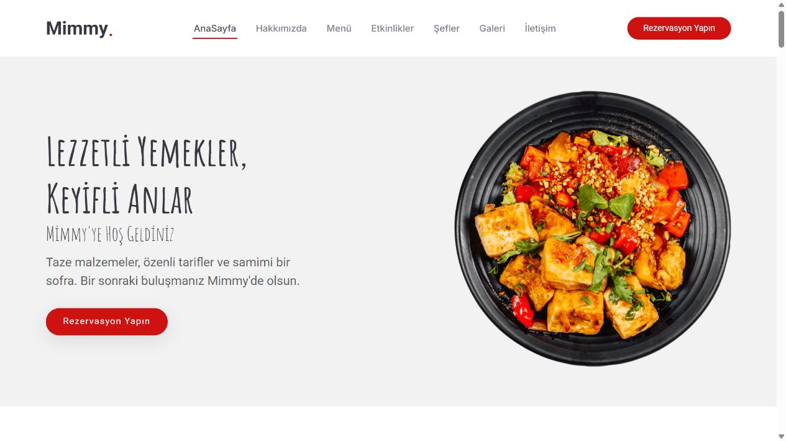

# MimmyApi 🍽️

ASP.NET Core ile geliştirilen restoran sitesi ve yönetim paneli. REST API, SQL Server, Entity Framework Core ve yapay zekâ destekli tarif/mesaj araçlarını bir araya getirir.

Fatih Kılıç tarafından, Murat Yücedağ'ın [API Proje Kampı](https://www.youtube.com/playlist?list=PLKnjBHu2xXNOzMUJ4I57MgWUKCzyZMH03) eğitimi temel alınarak geliştirilmiştir.



## Özellikler

- API'den beslenen ana sayfa: giriş alanı, hakkımızda, menü, yorumlar, etkinlikler, şefler, galeri ve iletişim.
- Kategoriye göre filtrelenebilen restoran menüsü.
- Rezervasyon ve iletişim formları; veritabanına kayıt ve doğrulama.
- Kategori, ürün, içerik, galeri, rezervasyon ve mesaj yönetimi.
- Gerçek verilerle gösterge paneli ve restoran istatistikleri.
- OpenAI ile malzemelere göre tarif ve günlük menü önerisi.
- Müşteri mesajları için AI yanıt taslakları; taslaklar otomatik olarak gönderilmez.
- SignalR üzerinden AI sohbet ve sınırlı sohbet geçmişi.
- Korumalı POST formları, eksik kayıtlar için 404 ve API doğrulama hatalarının formda gösterilmesi.
- Otomatik testler ve GitHub Actions derleme/test akışı.

## Teknolojiler

.NET 8 · ASP.NET Core Web API & MVC · SQL Server/LocalDB · Entity Framework Core 8 · AutoMapper · FluentValidation · SignalR · Bootstrap · OpenAI Responses API.

## Proje yapısı

```text
ApiProjeKampi.WebApi/   REST API, entity'ler, migration'lar ve örnek veriler
ApiProjeKampi.WebUI/    MVC arayüzü, yönetim paneli ve AI servisleri
MimmyApi.Tests/        AI servisinin başarı/hata/iptal testleri
scripts/               Veritabanı kurulum betiği
.github/workflows/     GitHub Actions
```

## Yerel kurulum

Gerekenler: .NET 8 veya daha yeni SDK, SQL Server ya da Windows SQL Server Express LocalDB.

```powershell
git clone https://github.com/fatihk123/MimmyApi.git
cd MimmyApi
dotnet tool restore
dotnet restore ApiProjeKampi.sln
```

Geliştirme ortamındaki varsayılan veritabanı, `(localdb)\MSSQLLocalDB` sunucusundaki **MimmyApiDb** veritabanıdır. Önce migration'ları uygulayın:

```powershell
$env:ASPNETCORE_ENVIRONMENT = "Development"
dotnet ef database update --project ApiProjeKampi.WebApi
```

Alternatif olarak Windows'ta:

```powershell
.\scripts\Initialize-Database.ps1
```

Mevcut veritabanınızı kullanmak için bağlantıyı ortam değişkeniyle değiştirin. Mevcut `MimyProjeKampiDb` veritabanı otomatik olarak taşınmaz veya silinmez:

```powershell
$env:ConnectionStrings__DefaultConnection = "Server=SUNUCU_ADI;Initial Catalog=MimyProjeKampiDb;Integrated Security=true;TrustServerCertificate=True;"
```

Linux/macOS'ta SQL Server bağlantınızı aynı değişkenle yapılandırın; LocalDB Windows içindir. Parola içeren bağlantıları kaynak koduna yazmayın.

### Çalıştırma

İlk terminal — API (HTTPS profili):

```powershell
dotnet run --project ApiProjeKampi.WebApi --launch-profile https
```

İkinci terminal — arayüz:

```powershell
dotnet run --project ApiProjeKampi.WebUI
```

- Restoran sitesi: https://localhost:7162/
- Yönetim paneli: https://localhost:7162/Dashboard/Index
- Swagger: https://localhost:7192/swagger

HTTPS sertifikası henüz güvenilir değilse `dotnet dev-certs https --trust` çalıştırın.

API adresi `ApiProjeKampi.WebUI/appsettings.json` içindeki `Api:BaseUrl` ayarından veya `Api__BaseUrl` ortam değişkeninden değiştirilebilir.

### İsteğe bağlı örnek veriler

Yeni ve boş veritabanında demo içerik oluşturmak için API'yi başlatmadan önce:

```powershell
$env:Database__SeedDemoData = "true"
dotnet run --project ApiProjeKampi.WebApi --launch-profile https
```

Örnek veriler yalnızca Development ortamında, açıkça istendiğinde ve tüm ilgili tablolar boşsa eklenir. Mevcut restoran verileri değiştirilmez. Demo iletişim bilgileri, fiyatlar ve misafir yorumu örnektir.

## OpenAI kurulumu

AI ekranları API anahtarı olmadan da açılır; anahtar tanımlanınca gerçek öneriler üretir. Anahtarı GitHub'a veya tarayıcı koduna eklemeyin.

Yerel geliştirme için .NET User Secrets kullanın:

```powershell
dotnet user-secrets set "OpenAI:ApiKey" "KENDI_API_ANAHTARINIZ" --project ApiProjeKampi.WebUI
```

Alternatif: `OPENAI_API_KEY` veya `OpenAI__ApiKey` ortam değişkeni. Varsayılan model **gpt-4.1-mini**; `OpenAI:Model` / `OpenAI__Model` ile değiştirilebilir. API hesabının bu modele erişimi ve yeterli kotası olmalıdır.

Resmi kaynaklar: [metin üretimi](https://developers.openai.com/api/docs/guides/text), [GPT-4.1 mini](https://developers.openai.com/api/docs/models/gpt-4.1-mini).

Tarif, günlük menü, mesaj taslağı ve sohbet istekleri OpenAI'ye gönderilir. API anahtarı yalnızca sunucuda kullanılır. Yanıtlar HTML olarak çalıştırılmaz. Responses isteklerinde `store=false` kullanılır. Bu uygulama e-posta göndermez.

## Doğrulama

```powershell
dotnet build ApiProjeKampi.sln --configuration Release
dotnet test ApiProjeKampi.sln --configuration Release
```

AI testleri sahte bir HTTP sağlayıcısı kullanır; gerçek anahtar veya ücretli API çağrısı gerektirmez. Canlı AI doğrulaması için kendi anahtarınız gereklidir.

PowerShell 7 ile çalışan yerel API ve arayüz üzerinde uçtan uca kontroller:

```powershell
.\scripts\Smoke-Test.ps1
# Ayrı bir test veritabanında geçici kayıtları oluşturup temizlemek için:
.\scripts\Smoke-Test.ps1 -AllowWrites
```

## Kapsam ve kaynaklar

Bu sürüm yerel eğitim/portfolyo kullanımına yöneliktir. Yönetim paneli ve REST API için kullanıcı girişi henüz yoktur; uygulamayı internete açmadan önce kimlik doğrulama ve yetkilendirme eklenmelidir. GitHub'da kaynak kodu paylaşmak, uygulamayı canlı sunucuya dağıtmak anlamına gelmez.

Bitmiş eğitim projesi, eksik akışları karşılaştırmak için referans alınmıştır. Mimmy adı, mevcut model/DTO yapısı ve kendi migration geçmişi korunmuştur. Hugging Face moderasyonu, çalışan görevleri ve grup rezervasyonu bölümleri bu sürümün kapsamına dahil değildir.

Arayüz temaları: [Yummy / BootstrapMade](https://bootstrapmade.com/yummy-bootstrap-restaurant-website-template/) ve Otika Bootstrap Admin. Tema ve üçüncü taraf varlıkların kendi lisansları geçerlidir. AutoMapper 15 için üretim kullanımında [sağlayıcının lisans koşulları](https://docs.automapper.io/en/stable/License-configuration.html) ayrıca kontrol edilmelidir.
